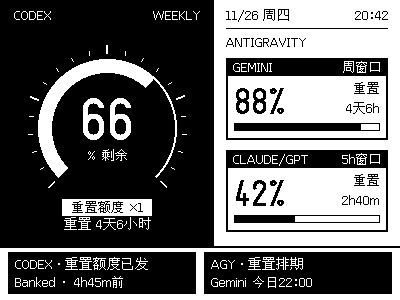

# NOTE4 上的 Codex 与 Gemini 额度看板

把 ZECTRIX NOTE4 放在桌边，一眼看出 Codex 本周还剩多少额度，以及 Antigravity 里的 Gemini 离哪个用量上限更近。Mac 在后台读取额度，把变化画成一张 400 × 300 的黑白墨卡。



上图用示例数据渲染。左侧圆环旁的 `CR×1` 表示有一次可用的 Codex 重置机会。右侧两张卡各有自己的重置倒计时。哪个窗口暂时读不到，就在那张卡上标「旧」并保留上次读数；从未读到的窗口显示「暂不可用」。看到 `0%` 才表示该窗口额度确已用尽。

底部条纹提示有待执行的重置排期，或过去 24 小时内已确认的重置。排期优先显示。Gemini 一侧会过滤仅涉及 Claude 或 GPT 的公告，平时只显示「暂无排期」。

## 先在 Mac 上看一张

准备好 Rust 和 Cargo 后，在终端运行以下命令。示例预览只读取仓库内的数据，无需登录账号或连接 NOTE4。

```sh
git clone https://github.com/BarryBarrywu/ai-quota-zectrix-dashboard.git
cd ai-quota-zectrix-dashboard
cargo install --locked --path .
ai-quota-zectrix-dashboard preview --input fixtures/normal.json --output preview.png
open preview.png
```

要看自己的额度，先在这台 Mac 上登录 Codex CLI 和 Antigravity CLI（`agy`），再生成本地预览：

```sh
ai-quota-zectrix-dashboard live-preview --output live.png
open live.png
```

## 显示到 NOTE4

准备一台已绑定到极趣云的黑白 NOTE4 和对应账号的 API Key。运行交互式设置，选择设备和墨卡槽位（1–5）。看过预览后，输入 `y` 确认替换该槽位的图片。设置成功后，API Key 保存在 macOS 钥匙串中。

```sh
ai-quota-zectrix-dashboard setup
```

NOTE4 会在下一次联网同步时取回图片。要看真机效果，长按侧边键进入「扩展页面」，查看刚才选择的墨卡槽位。如果仍是旧画面，可在「设置 → 网络同步 → 同步周期」检查自动同步是否开启。[NOTE4 操作指南](https://www.zectrix.com/m.html)

确认画面后，安装后台服务，之后每次登录 macOS 都会自动启动：

```sh
ai-quota-zectrix-dashboard launch-agent install
```

## 更新与诊断

Mac 通常每 10 分钟读取一次额度，启动时及之后每小时检查一次公开重置消息。只有画面内容变化才会上传，两次上传至少间隔 60 秒。NOTE4 按设备自己的同步周期取图。

```sh
ai-quota-zectrix-dashboard diagnostics
```

查看 `gemini_five_hour` 和 `gemini_weekly` 可分别判断两个窗口的数据是否新鲜。`current` 表示本次读取成功，`stale` 表示正使用缓存，`unavailable` 表示没有可用读数。`publisher` 反映 Mac 向云端发布的状态，真机刷新时间取决于设备同步。

要停止后台更新并移除登录项，运行 `ai-quota-zectrix-dashboard launch-agent remove`。额度来源、可选的 statusLine 快照和代理配置见[产品说明](PRODUCT.md)。
